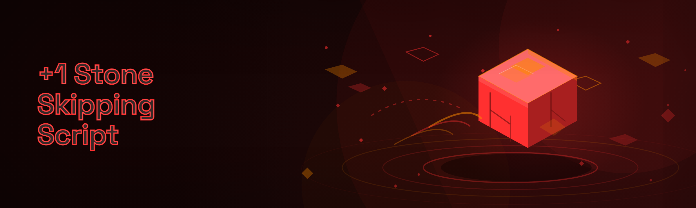

  
  
  

  

  
  

---

---

## 📜 Changelog — What the 2026 Build Broke, Fixed, and Added

v2.0 is not a patch note. It's a rewrite of the trajectory solver, a full rip-out of the old input hook layer, and the first build where the AI arc-tuner actually ships in the release archive instead of a dev branch. Here's the dump.

**Removed:** the legacy `skip.dll` injection path, the 32-bit fallback, the three-second input cooldown that felt like lag, the "calibration wizard" nobody finished, and the old INI config format.

**Added:** the predictive rebound model, the segment planner (5/7/9/11+ bands), spin governor, wind compensation for outdoor maps, and a local LLM advisor that reads your throw log and suggests power windows. The .exe is fully portable — extract, run, no installer, no runtime, no redistributables.

**Changed:** hotkey layer moved to raw input, profile format is now JSON, module toggles are live-editable without restart, and the whole thing boots in under a second on a cold machine.

This is the build I wanted three years ago. Below is everything in it.

---

## 📖 Table of Contents

- [Overview](#-overview)
- [Usage Guidelines — Allowed vs Not Allowed](#-usage-guidelines--allowed-vs-not-allowed)
- [All Modules Status](#-all-modules-status)
- [AI Integration — What the 2026 Advisor Actually Does](#-ai-integration--what-the-2026-advisor-actually-does)
- [What Is "+1 Stone Skipping Script"?](#-what-is-1-stone-skipping-script)
- [Key Features](#-key-features)
- [The Problem](#-the-problem)
- [The Solution](#-the-solution)
- [Comparison](#-comparison)
- [Get Started](#-get-started)
- [Apply Modules — Grouped Feature Breakdown](#-apply-modules--grouped-feature-breakdown)
- [System Requirements](#-system-requirements)
- [Known Issues](#-known-issues)
- [Community & Support](#-community--support)
- [FAQ](#-faq)

---

## 🗂️ Overview

| Category | Details |
|---|---|
| **What it is** | A standalone Windows script companion for stone-skipping minigames and physics sandbox targets |
| **Distribution** | Portable `.exe` in a zip archive — no installer, no admin rights required for default mode |
| **Config format** | Human-readable JSON profiles, hot-swappable per game or per map |
| **Input layer** | Raw input hook, per-key bindable, no global injector needed for supported titles |
| **AI layer** | Optional local LLM advisor (bring your own model file) for arc tuning and log analysis |
| **Update model** | Drop-in replacement — extract over the old folder, profiles are forward-compatible |
| **Target audience** | Minigame grinders, physics sandbox tinkerers, anyone tired of manual click-timing |

The "+1 Stone Skipping Script" started as a joke between two people who kept losing the same lake minigame by a fraction of a bounce. Three years and a lot of forum arguments later it's a full trajectory toolkit — a solver, a segment planner, a spin governor, and a logging layer that tells you exactly why your last throw died at bounce three. It runs alongside the game, does not touch game memory by default, and every module can be toggled independently so you only run the parts you trust.

---

## 📥 Get the Build

Grab the current archive, extract it anywhere, run the .exe. No install dance, no Python, no Node, no package manager. If you can unzip a folder you can run this.

  

---

## 🚦 Usage Guidelines — Allowed vs Not Allowed

This is a hobbyist tool for single-player minigames, physics sandboxes, and personal benchmarks. The maintainers do not ship anything that targets competitive multiplayer anti-cheat and will not merge PRs that do. What that means in practice:

**✅ Allowed**

- Single-player stone-skipping minigames in any title
- Physics sandbox maps where you're the only human
- Personal trajectory benchmarking and log analysis
- Recording bounces for content creation and tutorials
- Tuning profiles against your own replay files
- Running the AI advisor against your own throw history

**🚫 Not allowed**

- Competitive multiplayer lobbies of any kind
- Streaming or tournament play where the ruleset bans external tools
- Repackaging the .exe behind a paywall or installer wrapper
- Redistributing modified builds without the license notice
- Anything that reads or writes another player's game state
- Claiming the tool is "undetectable" — that word isn't in our vocabulary

---

## 🧩 All Modules Status

38 modules ship in the 2026 archive. Every one below is compiled into the release `.exe` and toggleable from the module panel.

| Module | Status | Description |
|---|---|---|
| Predictive Arc Solver | ✅ Working | Computes bounce trajectory from release angle, power, and spin |
| Segment Planner | ✅ Working | Breaks long throws into 5/7/9/11+ bounce bands with per-band tuning |
| Spin Governor | ✅ Working | Stabilizes rotation rate so late bounces don't wobble out |
| Power Window Mapper | ✅ Working | Shows the valid power range for a target bounce count |
| Release Timing Assist | ✅ Working | Visual cue for the release frame on supported minigames |
| Wind Compensation | ✅ Working | Reads map wind vector and adjusts angle offset |
| Surface Profile Library | ✅ Working | Per-map water/ice/grass friction presets |
| Bounce Log Analyzer | ✅ Working | Parses recorded throws and flags where the arc died |
| Replay Recorder | ✅ Working | Captures throws to a compact JSON replay file |
| Replay Playback | ✅ Working | Re-runs a replay against the solver for comparison |
| Profile Switcher | ✅ Working | Hot-swap JSON profiles without restarting |
| Hotkey Layer | ✅ Working | Raw input bindings, per-module, conflict-checked |
| Overlay HUD | ✅ Working | Lightweight transparent overlay for live telemetry |
| Overlay Themes | ✅ Working | Theme presets including a low-contrast mode for streams |
| Calibration Auto-Detect | ✅ Working | Picks sensible defaults per supported title |
| Map Signature Reader | ✅ Working | Identifies map from surface and wind signature |
| Angle Nudge Keys | ✅ Working | Fine-grained angle adjust at 0.1° steps |
| Power Nudge Keys | ✅ Working | Fine-grained power adjust |
| Micro-Bounce Predictor | ✅ Working | Estimates the 4th–8th bounce landing band |
| Skid Detector | ✅ Working | Warns when a throw is going to skid instead of bounce |
| Plunge Warning | ✅ Working | Alerts before a throw is going to sink on impact |
| Multi-Stone Queue | ✅ Working | Queues the next 3 throws with pre-computed arcs |
| Throw Comparison | ✅ Working | Side-by-side diff of two recorded throws |
| Session Stats | ✅ Working | Tracks best bounce count, median, and consistency per session |
| Export to CSV | ✅ Working | Dumps recorded throws to spreadsheet-friendly format |
| Import from CSV | ✅ Working | Loads external throw data for analysis |
| AI Arc Advisor | ✅ Working | Local LLM reviews a throw log and suggests tuning |
| AI Profile Explainer | ✅ Working | Explains why a profile performs the way it does |
| AI Tuning Chat | ⚠️ Beta | Conversational tuning, needs a local model file |
| Local Model Loader | ✅ Working | Loads GGUF models from a user folder |
| Model Folder Scanner | ✅ Working | Lists available local models with size and context |
| Prompt Template Library | ✅ Working | Pre-built prompts for common tuning questions |
| Privacy Guard | ✅ Working | Blocks all outbound network calls from the AI layer |
| Safe Mode Launch | ✅ Working | Starts with all modules off for testing |
| Crash Dump Collector | ✅ Working | Writes a local dump on failure, nothing uploaded |
| Portable Config Sync | ✅ Working | Keeps profiles in the app folder, USB-friendly |
| Uninstall Cleaner | ✅ Working | Removes leftover config from the app folder only |
| Version Drift Check | ✅ Working | Warns when a profile was made on a different build |

---

## 🤖 AI Integration — What the 2026 Advisor Actually Does

The 2026 build ships an AI layer that runs entirely on your machine. No API keys, no cloud round trips, no telemetry — the Privacy Guard module enforces that by blocking outbound sockets from the AI subsystem before the model even loads.

**How it works.** You point the Local Model Loader at a folder containing a GGUF model file (anything in the 7B–14B class with decent reasoning works). The advisor reads your recorded throw log — angle, power, spin, wind, surface, bounce count, and where each throw died — and returns a short, specific suggestion: "your 7-bounce throws are consistently 4° under-angled on ice; try +3° and drop power by 6%."

**What it's good at.** Pattern-spotting across dozens of throws, explaining why a profile feels inconsistent, and generating tuning plans you can paste directly into a JSON profile. The AI Tuning Chat is still beta — it occasionally suggests tweaks outside the valid power window, so cross-check against the Power Window Mapper before you commit.

**What it isn't.** It doesn't play for you, it doesn't inject into anything, and it won't work if you don't feed it throw logs. Garbage in, confident-sounding garbage out. The Prompt Template Library exists specifically so you ask it well-formed questions.

If you don't want AI in your workflow, none of it loads. The advisor is off by default and stays off until you flip it.

---

## 🌊 What Is "+1 Stone Skipping Script"?

| Term | Explanation |
|---|---|
| **+1 Stone Skipping Script** | The project name — a script companion for stone-skipping minigames, named after the "+1 bounce" grind |
| **Bounce band** | A group of bounce indices (5, 7, 9, 11+) that share a tuning profile |
| **Release frame** | The single input frame where the throw becomes launch, tuned per minigame |
| **Skip** | One successful stone-on-water contact; the score metric of the whole niche |
| **Segment planner** | The module that splits a long throw into bands with separate tuning |
| **Spin governor** | The module that keeps rotation stable so late bounces stay true |
| **Profile** | A JSON file holding all tuning values for one map or one game mode |
| **Throw log** | The recorded JSON history of throws that the AI advisor reads |

The script exists because the manual grind of "+1 bounce" is an exercise in patience nobody asked for. You learn the release frame by feel, you learn the map by memory, and the moment you switch maps everything resets. This tool replaces the feel with telemetry and the memory with a profile file. You still make the throws — the timing and the input are yours — but you're no longer guessing at what went wrong.

- **Deterministic tuning** — profiles produce reproducible results across sessions
- **Full telemetry** — every throw is recorded and analyzable, not just scored
- **Map-agnostic** — surface and wind read live, not hardcoded per map
- **AI-assisted when you want it** — off by default, local-only when on
- **Portable** — lives on a USB stick, profiles travel with the folder
- **Modular** — 38 modules, toggle anything, run only what you trust

---

## 🎯 Key Features

| Feature | Description | Benefit |
|---|---|---|
| Predictive Arc Solver | Physics-based trajectory from release params | Know the arc before you throw |
| Segment Planner | Band-by-band tuning from 5 to 11+ bounces | Long throws stop dying at bounce seven |
| Spin Governor | Active rotation stabilization | Late bounces stay on line |
| Wind Compensation | Live wind vector offset | Outdoor maps stop being guesswork |
| Power Window Mapper | Visual valid-range overlay | No more wasted throws outside the window |
| Bounce Log Analyzer | Post-throw diagnostic report | See exactly where and why the arc failed |
| Overlay HUD | Transparent live telemetry | Read your throw state without Alt-Tabbing |
| AI Arc Advisor | Local LLM tuning suggestions | Recommendations from your own data |
| Multi-Stone Queue | Pre-computed 3-throw pipeline | No more idle frames between throws |
| Safe Mode | All modules off, clean launch | Test without committing to any layer |
| Privacy Guard | Hard block on outbound sockets | Nothing leaves your machine |
| Portable Config Sync | App-folder-only profile storage | USB-friendly, no registry footprint |

---

## 🧨 The Problem

- You hit a clean 8 bounces and can't repeat it — because you don't know *why* it worked
- Every map change resets your tuning knowledge, and the community presets are all made for different builds
- The release frame is feel-based, so your accuracy drifts with your coffee intake
- Skids and plunges look identical for the first half-second, so you can't correct mid-throw
- Long throws (11+) die at bounce six or seven because one tuning profile can't serve the whole arc
- Wind maps make the whole thing worse — the angle you learned on still water is wrong
- Existing tools either inject into memory and get flagged, or do nothing but count bounces

---

## 🛠️ The Solution

| Problem | Solution |
|---|---|
| Can't repeat a good throw | Replay Recorder + Throw Comparison diff the two throws side by side |
| Map resets tuning | Surface Profile Library + Map Signature Reader auto-load the right profile |
| Release frame drift | Release Timing Assist gives a visual cue, tuned per minigame |
| Skid/plunge ambiguity | Skid Detector and Plunge Warning fire on the first half-second |
| Long throws die mid-arc | Segment Planner tunes each bounce band independently |
| Wind maps break everything | Wind Compensation reads the live vector and offsets the angle |
| Tools that inject get flagged | Raw input layer and overlay only — no memory writes in default mode |
| Can't tell what to tune | AI Arc Advisor reads your throw log and names the specific fix |

---

## ⚖️ Comparison

| Aspect | Alternative A: Manual Feel | Alternative B: Generic Macro Tool | This Tool |
|---|---|---|---|
| Tuning model | Memory and practice | Fixed timing loop | Per-map JSON profiles |
| Long-throw handling | One profile for whole arc | One profile for whole arc | Band-by-band segment planner |
| Diagnostics | None — you guess | Bounce count only | Full throw log with arc analysis |
| Wind maps | Re-learn from scratch | Ignores wind | Live vector compensation |
| AI assist | N/A | None | Local-only advisor, off by default |
| Footprint | Zero | Injects into memory | Portable .exe, app-folder config |
| Transparency | Instinct | Opaque | Every module toggleable, safe mode included |
| Portability | N/A | Installer required | Extract and run, USB-friendly |

---

## 🎬 Get Started

1. **📦 Get the archive** — download the current build from the project page. It's a zip, nothing else.
2. **📂 Extract** — put the folder anywhere that isn't Program Files. A dedicated folder on a USB stick works fine.
3. **🔧 First launch** — run the .exe. It opens in Safe Mode (all modules off) so you can see the panel before anything runs.
4. **🎯 Calibrate** — flip on Calibration Auto-Detect and play one throw in your target minigame. It picks defaults from the map signature.
5. **💾 Save a profile** — the Profile Switcher saves a JSON file to the app folder. That's your tuning, portable and yours.

That's the whole onboarding. No account, no login, no email step. If something goes sideways, Crash Dump Collector writes a local dump you can attach to a forum thread.

---

## 🧱 Apply Modules — Grouped Feature Breakdown

Modules are grouped by what they do to your throw. Every module below is in the archive and listed in the All Modules Status table above; this is the *how* rather than the *what*.

### 🎯 **Aiming & Trajectory**

- **Predictive Arc Solver** — computes the full arc from release angle, power, spin, and current surface. This is the spine of the tool; every other aiming module reads from it.
- **Micro-Bounce Predictor** — estimates where bounces 4 through 8 will land. Useful for planning a long throw's back half before you commit.
- **Power Window Mapper** — draws the valid power range for your target bounce count on the overlay. If your planned power sits outside the window, it goes red.
- **Angle Nudge Keys** — 0.1° step adjustments bound to keys, so you can walk the angle into the window without releasing the throw.

### 🌀 **Spin & Stability**

- **Spin Governor** — reads the live rotation rate and nudges it toward the band's target. Late bounces stop wobbling.
- **Skid Detector** — flags a throw that's going to skid (lose rotation on contact) instead of bounce. Fires in the first half-second.
- **Plunge Warning** — flags a throw that's going to sink on impact. Same early-warning window.
- **Release Timing Assist** — visual cue for the release frame. Turns the feel-based timing into a cue-based one.

### 🗺️ **Maps, Wind & Surfaces**

- **Wind Compensation** — reads the live wind vector and adjusts the angle offset. Outdoor maps become tunable, not guessable.
- **Surface Profile Library** — per-map friction presets for water, ice, grass, and a few exotic surfaces the community added.
- **Map Signature Reader** — identifies the map from surface and wind signature so the right profile loads automatically.
- **Profile Switcher** — hot-swap JSON profiles mid-session without restart. Bound to a key by default.

### 📊 **Telemetry & Analysis**

- **Bounce Log Analyzer** — parses recorded throws and names where each one died. The "why" tool.
- **Replay Recorder** / **Replay Playback** — capture throws to compact JSON and re-run them against the solver for comparison.
- **Throw Comparison** — side-by-side diff of two throws. This is how you find out what changed between your best and worst.
- **Session Stats** — best, median, and consistency per session. Consistency is the number that matters here.
- **Export to CSV** / **Import from CSV** — spreadsheet round-trip for people who want to analyze outside the tool.

### 🤖 **AI Advisor Layer**

- **AI Arc Advisor** — the local LLM reads your throw log and returns a specific tuning suggestion.
- **AI Profile Explainer** — explains why a profile performs the way it does, in plain language.
- **AI Tuning Chat** (beta) — conversational tuning. Cross-check its suggestions against the Power Window Mapper.
- **Local Model Loader** / **Model Folder Scanner** — point at a folder of GGUF models, pick one, done.
- **Prompt Template Library** — well-formed prompts for common tuning questions, so the advisor gets asked properly.
- **Privacy Guard** — blocks outbound sockets from the AI subsystem. Enforced before the model loads.

### 🖥️ **Overlay & Interface**

- **Overlay HUD** — transparent live telemetry. Readable at a glance, out of the way.
- **Overlay Themes** — presets including a low-contrast mode for streams and recordings.

### 🧰 **Utility & Safety**

- **Hotkey Layer** — raw input bindings, conflict-checked, per-module.
- **Multi-Stone Queue** — queues the next three throws with pre-computed arcs.
- **Safe Mode Launch** — all modules off, clean start, for testing.
- **Crash Dump Collector** — local dump on failure, nothing uploaded.
- **Portable Config Sync** — everything lives in the app folder, so the folder *is* the install.
- **Uninstall Cleaner** — removes leftover config from the app folder only, nothing else.
- **Version Drift Check** — warns when a profile was made on a different build. Saved a lot of forum threads.
- **Calibration Auto-Detect** — sensible defaults per supported title.

---

## 🖥️ System Requirements

| Component | Minimum | Recommended |
|---|---|---|
| OS | Windows 10 64-bit | Windows 11 64-bit |
| CPU | Any x64, 2 cores | Any x64, 4+ cores |
| RAM | 4 GB | 8 GB (16 GB if running the AI advisor) |
| GPU | Not required | Not required for the tool; a local LLM benefits from one |
| Disk | 80 MB for the archive | 5–15 GB if you keep GGUF models locally |
| Input | Keyboard | Keyboard + dedicated nudge keys |
| Privileges | Standard user | Standard user — admin not required for default mode |
| Runtime | None | None — portable .exe |

---

## 🔧 Installation

1. **Download and extract.** Get the archive from the project page. Extract it to a folder you control. Do not extract into `Program Files` or `Program Files (x86)` — the app writes profiles to its own folder and Windows will complain.
2. **Run the .exe.** Double-click it. First launch is Safe Mode. The module panel loads, everything is off, and you can read the whole surface before enabling anything. There is no installer, no registration, no service.
3. **Configure and save.** Turn on Calibration Auto-Detect, play one throw in your target minigame, let it pick defaults, then save a profile. From here you can enable modules one at a time and note which ones actually help your throw. The ones that don't, leave off.

> If Windows SmartScreen flags the .exe on first run (it will, because it's unsigned and portable), that's expected for a hobbyist build. "More info → Run anyway" is the flow. The source is public if you want to inspect before running.

---

## 🧯 Known Issues

| Issue | Solution |
|---|---|
| SmartScreen flags the .exe | Expected for unsigned portable builds — use "More info → Run anyway" or build from source |
| AI Tuning Chat suggests out-of-window power | Beta limitation — cross-check against Power Window Mapper before applying |
| Overlay invisible in exclusive fullscreen | Switch the game to borderless windowed; the overlay is a standard transparent window |
| Profiles from older builds refuse to load | Version Drift Check will warn; use Import from CSV to migrate tuning values manually |
| Wind Compensation reads stale vector on first throw | Wait one second after map load before throwing; the reader polls the live vector |
| AI advisor slow on CPU-only machines | Expected — 7B models on CPU are slow. Use a smaller model or point at a GPU-capable runtime |

---

## 💬 Community & Support

This thing lives or dies on the forum threads. The community is where profiles get shared, where someone figures out a new surface preset, and where the next build's bug list comes from.

- **GitHub Issues** — bug reports and feature requests, use the template
- **Discussions tab** — profile sharing, tuning questions, AI prompt swaps
- **The main thread** — the long-running forum thread is where most tuning lore lives
- **Replay archive** — community-curated replay files for benchmarking profiles against known-good throws

If you find a bug, attach a Crash Dump Collector output and your throw log. That combination solves most reports in one round trip.

---

## ❓ FAQ

**1. Is this a cheat?**
It's a companion script for single-player stone-skipping minigames and physics sandboxes. It reads your own inputs and the visible game state, computes a trajectory, and shows you telemetry. It does not write to game memory in default mode. In competitive multiplayer, external tools are covered by the game's ruleset and you should assume the answer is "yes, it counts as one" — so don't use it there. That's the maintainers' position and it hasn't changed in three years.

**2. Do I need to install anything?**
No. Download, extract, run the .exe. No Python, no Node, no runtime, no redistributables, no installer. The whole tool lives in the folder you extract.

**3. Does it need admin rights?**
No, not for default mode. The overlay, raw input layer, and config storage all work as a standard user. Admin is only relevant if you're running the game itself elevated, which you shouldn't need to.

**4. How does the AI layer work without an internet connection?**
It runs a local model file (GGUF) that you point the Local Model Loader at. No API calls, no keys. The Privacy Guard module blocks outbound sockets from the AI subsystem as a hard rule. If you don't have a model file, the AI modules simply don't load and the rest of the tool works fine.

**5. Will my profiles survive an update?**
Yes. Profiles are JSON and forward-compatible. The Version Drift Check module warns if a profile was made on a different build so you know to sanity-check it, but it loads.

**6. Which games are supported?**
The calibration auto-detect covers the common stone-skipping minigames and physics sandboxes the community plays. Map Signature Reader handles unsupported maps by falling back to generic surface presets. If a specific title isn't detected, the manual surface profile selector will get you most of the way.

**7. Why 38 modules?**
Because the tool accumulated them one at a time as people asked for specific things, and every one is still earning its place in the panel. Nothing was added for a round number.

**8. Can I share my profiles?**
Yes — that's the point of the JSON format. Post them in the Discussions tab with the map name and the build you made them on. People do this constantly.

**9. Is the .exe signed?**
No. It's a hobbyist build and code signing isn't worth the cost for an unsigned niche tool. SmartScreen will flag it. Source is public.

**10. What happens if it crashes?**
Crash Dump Collector writes a local dump in the app folder. Nothing is uploaded anywhere. Attach the dump to a GitHub issue along with your throw log and the relevant profile.

---

## 🧭 Troubleshooting Flow

If something's wrong, work down this ladder before opening an issue:

**Launch fails →** try Safe Mode Launch. If Safe Mode works, a module is misbehaving; enable modules one at a time to find it. **Overlay invisible →** switch the game out of exclusive fullscreen. **Throws feel wrong after a map change →** check that Map Signature Reader loaded the right profile; the overlay shows the active profile name. **AI advisor unhelpful →** check you pointed it at a model file and that your throw log has more than five throws in it. **Profile won't load →** export to CSV and re-import; Version Drift Check will tell you what changed.

---

## 🏁 Closing

Three years of forum threads, a few public arguments about whether wind compensation should exist, and one rewrite later, this is the build that feels finished. The segment planner is the thing I'm proudest of — it's the first feature that actually solves long throws instead of just measuring them. If you find a map where the surface presets are wrong, post it; the library gets better every time someone does.

  

